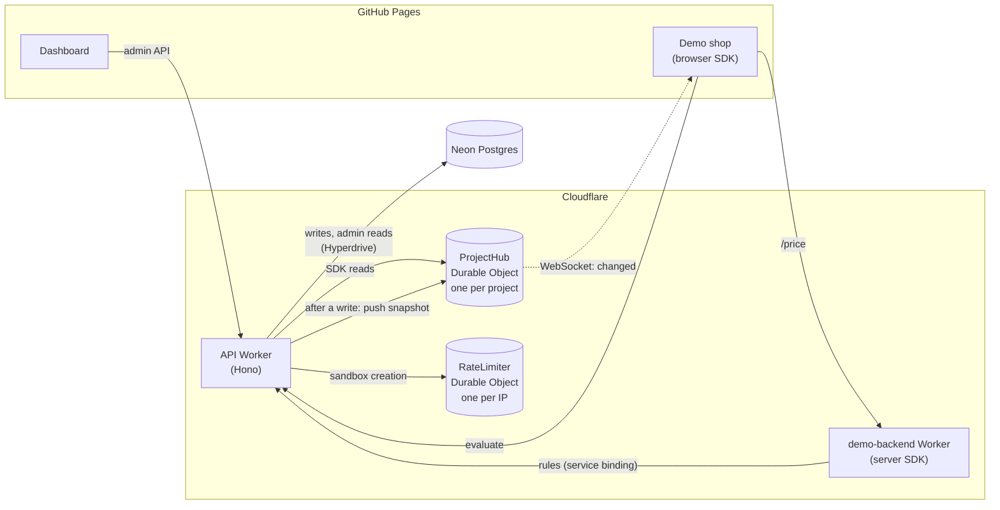

# Feature Flags

<p align="center">
  <a href="#the-30-second-demo">Quick Demo</a> ·
  <a href="#how-it-works">How It Works</a> ·
  <a href="#measured-numbers">Numbers</a> ·
  <a href="#limits">Limits</a> ·
  <a href="#repository-layout">Repository Layout</a> ·
  <a href="#using-the-sdks">SDKs</a> ·
  <a href="#local-development">Local Development</a> ·
  <a href="#how-it-runs-in-production">Production</a> ·
  <a href="#potential-future-features">Future Features</a> ·
  <a href="#checks">Checks</a>
</p>

A feature-flag service: flip a switch or change a rollout in a dashboard, and a website changes live - for everyone, for a percentage of visitors, or for visitors matching targeting rules. SDKs decide flags locally, so apps keep working when the service is down.

**Status:** Milestone 1 complete. The evaluation engine, the API (on Cloudflare Workers), the server and browser SDKs, the dashboard and the demo shop are deployed, with abuse limits, sandbox expiry, structured logs and automatic rollback.

**Live:**

- **Dashboard:** https://shehrozsf.github.io/feature-flags/dashboard/
- **Demo shop:** https://shehrozsf.github.io/feature-flags/demo/ (open it from the dashboard, which hands it your sandbox's keys)
- **API:** https://feature-flags-api.shehrozsf.workers.dev ([health](https://feature-flags-api.shehrozsf.workers.dev/health) shows the deployed commit)

## The 30-second demo

1. Open the **[dashboard](https://shehrozsf.github.io/feature-flags/dashboard/)** and click **Create my sandbox**. You get your own project with four seeded flags; nobody else sees them.
2. Click **Open the demo site ↗**. Put the two tabs side by side.
3. **Flip `promo-banner` off** in the dashboard. The shop's sale banner disappears within a couple of seconds, without a reload: the API pushes a `changed` message over a WebSocket and the browser SDK re-evaluates.
4. In the shop, **act as a visitor from Pakistan** (Country: Pakistan → _Act as this user_). JazzCash and Easypaisa appear: `pk-local-payments` has a targeting rule `country = PK`.
5. **Edit `new-pricing`** in the dashboard: set its rollout to **on 100% · off 0%** and save. Within a few seconds the price drops from $24 to $19. (It starts at 10% of visitors, and Pro visitors always get it through a rule: act as a Pro user to see that.) The price comes from a separate backend Worker that evaluates the flag with the **server** SDK, against the same sandbox.
6. Optional: open the same flag in two dashboard tabs, save both. The second save gets a **conflict** panel showing both versions instead of silently overwriting.

## How it works



- **Reads never touch Postgres.** Each project's **ProjectHub** Durable Object holds its rules and key hashes. SDK and browser requests are answered from it; only a cold hub loads from the database.
- **Writes go to Postgres first**, with optimistic locking (`If-Match`, 409 on conflict). After the commit, the Worker pushes a fresh snapshot to the hub. The hub tells every connected client `changed` over a WebSocket, and clients fetch the new rules or re-evaluate.
- **SDKs are built for outages.** The server SDK evaluates locally from its last good rules. The browser SDK caches results per visitor. Both reconnect with backoff, respect `Retry-After`, and detect dead sockets (no `pong` within 10 s of a `ping`).

### When things fail

| Situation                                     | What happens                                                                              |
| --------------------------------------------- | ----------------------------------------------------------------------------------------- |
| Postgres down, the project's hub is warm      | SDK reads keep working from the hub; admin routes answer `503` + `Retry-After`            |
| Postgres down, hub cold                       | `503` + `Retry-After`; SDKs keep serving their cached values                              |
| API unreachable                               | SDKs keep their last good values; the demo shop shows "Offline: showing saved values"     |
| Saved, but the push to the hub failed         | `200` with `x-propagation: delayed`; the hub catches up on its next stale read (≤ 30 min) |
| Two people edit the same flag                 | The second save gets `409` with the current flag; the dashboard shows both                |
| A socket dies silently (sleep, NAT timeout)   | No `pong` within 10 s of a `ping`: the SDK closes it and reconnects                       |
| A project is deleted while clients are online | Its hub keeps a permanent "deleted" marker: keys stop working, sockets close with `4404`  |
| A deploy fails its live smoke test            | Both Workers roll back to the versions that were live before (CI); the run stays red      |

## Measured numbers

Measured on 2026-11-11 against production (`tools/measure`), from a home connection far from the database's region.

**A flag change reaching clients** (30 flips, 10 open WebSockets, times from sending the change):

| Step                                       | p50      | p95      | max      |
| ------------------------------------------ | -------- | -------- | -------- |
| The save is answered (write + push to hub) | 1,938 ms | 2,037 ms | 2,095 ms |
| `changed` received, all 10 sockets         | 1,939 ms | 2,038 ms | 2,097 ms |
| New value in the browser SDK               | 2,391 ms | 2,573 ms | 2,797 ms |

- **Fan-out costs nothing measurable:** every socket hears `changed` the moment the save is answered.
- **After the save, a browser has the new value in ~0.45 s:** the SDK's 250 ms debounce plus one evaluate.
- **The save itself is the slow part (~1.9 s):** about 14 sequential queries (auth, validation, the transaction, loading the snapshot to push) travel from the Worker, which runs at the edge near the caller, to the database in its region. Next step: run the Worker next to the database (Cloudflare Smart Placement) and batch the queries. The spec's goal of ~1 s end to end isn't met yet.

**Evaluate latency** (`POST /v1/client/evaluate`, 50 in a row): the first request took **1,735 ms**, because it found the project's hub cold and loaded it from Postgres. The other 49:

| Requests  | p50    | p95    | max    |
| --------- | ------ | ------ | ------ |
| Warm (49) | 191 ms | 216 ms | 223 ms |

Warm requests are almost all network round trip; the evaluation itself takes microseconds:

**Evaluation engine** (`pnpm bench`, one laptop core, Node 24):

| Benchmark                        | Evaluations/s | p99       |
| -------------------------------- | ------------- | --------- |
| Boolean flag, no rules           | 4,001,441     | 0.0005 ms |
| 5 rules, the last one matches    | 1,069,195     | 0.0019 ms |
| Bucketing one user (MurmurHash3) | 534,670       | 0.0045 ms |
| 3-variant percentage rollout     | 390,530       | 0.0059 ms |

Reproduce:

```bash
pnpm measure:propagation https://feature-flags-api.shehrozsf.workers.dev   # flag flip → sockets and browser SDK
pnpm measure:evaluate https://feature-flags-api.shehrozsf.workers.dev      # evaluate latency
pnpm bench && pnpm bench:report                                            # evaluation engine
```

Each measurement script creates its own sandbox (one of the 5 an hour allowed per IP).

## Limits

The public demo is open to anyone, so it has limits (spec §9.2). Over a rate limit, the API answers `429` with `Retry-After`; over a size limit, `422` with the field at fault.

| What                     | Limit                                                                    | Over it                                    |
| ------------------------ | ------------------------------------------------------------------------ | ------------------------------------------ |
| Sandboxes created        | 5 an hour per IP                                                         | `429`; the dashboard says how long to wait |
| Evaluate calls           | 60 a minute per project (opening a client stream counts as one)          | `429`                                      |
| Live sandboxes           | 10,000                                                                   | The least recently used one is deleted     |
| Sandbox lifetime         | 30 days after the last dashboard use; an hourly job deletes expired ones | Deleted with its flags and keys            |
| Flags per project        | 50                                                                       | `422`                                      |
| Per flag                 | 10 variants, 20 rules, 10 conditions per rule, 32 KB of rules            | `422`                                      |
| Per project, in total    | 1 MB of variants and rules (what an SDK downloads)                       | `422`                                      |
| Open sockets per project | 100                                                                      | Closed with `1013` (try again later)       |
| Request body             | 64 KB, JSON at most 32 levels deep                                       | `413` / `422`                              |

Logs are one JSON line per event with a request id. Keys, evaluation contexts, IPs and error messages are never logged; a test sends known "canary" values through every route and fails if any of them reaches a log line.

## Repository layout

| Path                  | What it is                                                                                                      |
| --------------------- | --------------------------------------------------------------------------------------------------------------- |
| `packages/eval-core`  | Flag evaluation: MurmurHash3 bucketing, targeting rules, `evaluate()` / `evaluateAll()`                         |
| `packages/contracts`  | zod schemas and route registry for the API; `openapi.json` is generated from them; the shared stream protocol   |
| `packages/sdk-server` | Server SDK: streaming or polling, local evaluation, keeps the last good rules through outages                   |
| `packages/sdk-client` | Browser SDK: remote evaluation, cached per visitor, live updates, pauses in hidden tabs                         |
| `apps/api`            | The API (Hono): sandboxes, flag CRUD with optimistic locking, SDK rules, client evaluation, limits, expiry, MCP |
| `apps/dashboard`      | React dashboard: create a sandbox, flip flags, edit rules and rollouts, resolve edit conflicts                  |
| `apps/demo-site`      | Demo shop: each part follows one flag through the browser SDK, live                                             |
| `apps/demo-backend`   | The demo shop's pricing endpoint: a Worker evaluating `new-pricing` with the server SDK                         |
| `tools/bench-check`   | Benchmark comparison used by CI                                                                                 |
| `tools/smoke`         | Smoke test for a running API and pricing backend (`pnpm smoke <url>`), run by CI after every deploy             |
| `tools/measure`       | Latency measurements against a deployed API (the numbers above)                                                 |
| `tools/fault-proxy`   | Test helpers: a fake API and a proxy that takes the network down, delays it or corrupts it                      |

## Using the SDKs

Both SDKs never throw from `variation` and return your fallback when something is wrong (no rules yet, unknown flag, a value of another type).

**Server** (Node, or Workers in polling mode). Rules are evaluated locally:

```ts
import { createServerClient } from '@ff/sdk-server';

const flags = await createServerClient({ serverKey, baseUrl, mode: 'streaming' }); // ≤ 2 s, never rejects
flags.variation('new-pricing', { userId: 'u1', plan: 'pro' }, false);
flags.on('change', (version) => console.log('rules now at version', version));
// Workers: mode 'polling', and ctx.waitUntil(flags.pending()) so a background revalidation
// that variation() started isn't cut off when the response is sent (no extra requests).
```

**Browser.** The API evaluates for the visitor; results are cached and kept live:

```ts
import { createBrowserClient } from '@ff/sdk-client';

const flags = createBrowserClient({ clientKey, baseUrl, context: { country: 'PK' } }); // anonymous id added
await flags.ready(); // at once from cache, else after the first answer (≤ 2 s)
flags.variation('promo-banner', false);
flags.on('change', () => render());
await flags.identify({ userId: 'u42', country: 'PK', plan: 'pro' }); // after login
```

Resilience is tested by breaking the network on purpose: API down, recovery, slow start and malformed answers ([testing guide §9](docs/testing-guide.md), local).

## Using it from an AI assistant (MCP)

The API is also an [MCP](https://modelcontextprotocol.io) server at `/mcp`, so an assistant such as Claude Code can read and change a project's flags in plain English. Connect it with a sandbox's admin key:

```bash
claude mcp add --transport http flags https://feature-flags-api.shehrozsf.workers.dev/mcp \
  --header "Authorization: Bearer <admin key>"
```

Then ask things like _"which flags are mid-rollout?"_ or _"roll checkout-v2 out to 25%"_.

| Tool                  | Changes anything? | What it does                                                                                |
| --------------------- | ----------------- | ------------------------------------------------------------------------------------------- |
| `list_flags`          | no                | every flag, on or off, and who gets what in percentages                                     |
| `get_flag`            | no                | one flag in full, with per-rule percentages                                                 |
| `propose_flag_change` | no                | previews a change (before → after) and returns a confirm token                              |
| `apply_flag_change`   | **yes**           | makes exactly the previewed change (named by flag key and token); the only tool that writes |

Writes are safe by design: the assistant must show you the preview first, and the token it gets back is signed, bound to your project, valid for 5 minutes and tied to the flag's version. It can't change what you saw, be used twice, or overwrite someone else's newer edit. Add `?mode=read` to the URL for a connection that can only look.

## Local development

Requirements: Node 24, pnpm (`corepack enable`), Docker Desktop.

```bash
pnpm install

# Tests (integration tests start a throwaway Postgres in Docker)
pnpm test

# Run the API locally
docker compose up -d                                              # Postgres on localhost:5432
DATABASE_URL=postgres://ff:ff@localhost:5432/ff pnpm --filter @ff/api migrate
DATABASE_URL=postgres://ff:ff@localhost:5432/ff pnpm --filter @ff/api dev   # http://localhost:8787
```

Try it:

```bash
# Create a sandbox: returns a project id and admin / server / client keys
curl -s -X POST localhost:8787/v1/sandboxes

# Evaluate every flag for a visitor from Pakistan (use the client key from above)
curl -s -H "Authorization: Bearer <client key>" -H "content-type: application/json" \
     -d '{"context":{"userId":"u1","country":"PK"}}' localhost:8787/v1/client/evaluate
```

Run the dashboard and demo shop against it (each in its own terminal):

```bash
pnpm --filter @ff/dashboard dev      # http://localhost:5173/feature-flags/dashboard/
pnpm --filter @ff/demo-site dev      # http://localhost:5174/feature-flags/demo/
pnpm --filter @ff/demo-backend dev   # pricing backend on http://localhost:8790, reading the local API
```

On Windows PowerShell, set the variable first: `$env:DATABASE_URL = "postgres://ff:ff@localhost:5432/ff"`.

MCP is at `http://localhost:8787/mcp`. It is read-only unless `MCP_CONFIRM_SECRET` (32+ characters) is set too, e.g. `MCP_CONFIRM_SECRET=local-dev-secret-at-least-32-characters`.

The Node server keeps project hubs in memory and has no sandbox rate limit. To run the real Worker locally, with Durable Objects and WebSockets:

```bash
CLOUDFLARE_HYPERDRIVE_LOCAL_CONNECTION_STRING_HYPERDRIVE=postgres://ff:ff@localhost:5432/ff pnpm --filter @ff/api cf:dev
pnpm smoke http://localhost:8787     # every check, including the WebSocket one
```

## How it runs in production

- **Cloudflare Workers** runs the API (`apps/api/src/adapters/cloudflare/worker.ts`). Each project gets a **ProjectHub Durable Object** that caches its rules and key hashes and pushes change notices over WebSockets; a **RateLimiter Durable Object** per IP limits sandbox creation.
- **Neon Postgres** is the source of truth, reached through **Hyperdrive** (connection pooling, caching disabled).
- **A Cron Trigger runs hourly** and deletes expired sandboxes, up to 100 per run.
- **GitHub Pages** serves the dashboard and the demo shop as one site: `/feature-flags/dashboard/` and `/feature-flags/demo/`. A second Worker, **demo-backend**, prices the demo shop's product with the server SDK.
- **Deploys are automatic.** Every push to `main` that passes the `check` job runs the `deploy` job (the `bench` job runs on pull requests only, where it has a base branch to compare with): migrate Neon → deploy the API → deploy demo-backend → smoke test both (including CORS from the Pages origin) → confirm `/health` reports the new commit. If any step after a deploy fails, both Workers roll back to the versions that were live before; running the workflow by hand with `force_smoke_failure` rehearses that. The `pages` job then builds and publishes both apps. Deploys queue instead of overlapping.
- **Logs** go to Workers Logs (kept 3 days on the free plan) as JSON lines.
- **Worker secret it needs:** `MCP_CONFIRM_SECRET` (at least 32 random characters), set once with `wrangler secret put MCP_CONFIRM_SECRET` in `apps/api`; it signs MCP confirm tokens and survives deploys. Without it MCP is read-only, and the post-deploy smoke test fails the deploy (`--mcp-writes`) so that can't happen unnoticed.
- **GitHub secrets it needs:** `DATABASE_URL` (Neon's **direct** URL: migrations hold an advisory lock, which a pooled connection can't keep), `CLOUDFLARE_API_TOKEN`, `CLOUDFLARE_ACCOUNT_ID`. The token only needs _Workers Scripts: Edit_, _Account Settings: Read_ and _User Details / Memberships: Read_. If a deploy fails with `Authentication error [code: 10000]`, add the one permission the error names.

## Potential future features

Possible next steps if I come back to it, each shippable on its own:

- [ ] **Faster flag saves:** run the API Worker next to the database (Smart Placement) and batch the ~14 queries per save, aiming for the original ~1 s from a flip in the dashboard to the browser
- [ ] **Browser end-to-end tests** with Playwright
- [ ] **Account Tiers:** control privileges to certain flags
- [ ] **Environments and segments:** separate staging and production settings per flag; reusable audiences ("beta testers") in targeting rules
- [ ] **Audit log:** every change recorded with a diff, and one-click revert
- [ ] **Observability:** evaluations per flag (to spot stale flags), active sockets, error rates, and a public status page fed by the smoke test
- [ ] **Publish the SDKs to npm** with versioned releases and changelogs
- [ ] **Load testing** (k6): evaluate latency under concurrency and fan-out time to many sockets
- [ ] **A/B experiments:** record exposures and conversions, and report results with significance tests
- [ ] **Scheduled rollouts:** step a rollout up over time (5% -> 25% -> 100%), pausing automatically if something goes wrong
- [ ] **Prerequisite flags:** flag B only applies when flag A serves a given variant
- [ ] **Typed flag keys:** generate TypeScript types from a project's flags, so a typo in a flag key fails at compile time
- [ ] **More SDK languages** (for example Python), checked against the same contract and hash test vectors

## Checks

```bash
pnpm lint && pnpm format:check && pnpm typecheck && pnpm contracts:check && pnpm test:coverage
pnpm bench && pnpm bench:report     # evaluation benchmarks
```

The API is described by [`packages/contracts/openapi.json`](packages/contracts/openapi.json) (generated: run `pnpm --filter @ff/contracts openapi:write` after changing a schema).
